  

# 🚀 Awesome LLM Observability

> **The curated list of SaaS platforms and open-source GitHub projects for LLM observability** — tracing, evaluation, cost tracking, guardrails, and production monitoring for AI applications, RAG pipelines, and autonomous agents.

**Last updated: October 2026** · **27 open-source projects** · **16 SaaS platforms** · **Pricing, free-tier limits, and company size for every vendor**

This repository tracks the notable **SaaS platforms** and **open-source projects** for **LLM observability** — the tooling layer that lets teams see, debug, evaluate, and cost-control what their AI systems actually do in production. These tools provide **LLM tracing**, **prompt and completion logging**, **LLM-as-judge evaluation**, **token and cost tracking**, **PII redaction**, **guardrails**, and **real-time alerting** for LLM applications, RAG pipelines, and AI agents.

Category leaders covered here include **Datadog LLM Observability**, **LangSmith**, **Langfuse**, **Arize Phoenix**, **Helicone**, **WhyLabs**, **Fiddler AI**, **Braintrust**, **TruEra**, and **Arthur AI**.

**Open-source emphasis**: this section is heavily expanded with every major active project for self-hosting, OpenTelemetry-native instrumentation, and transparent evaluation — ideal for AI engineers, platform teams, and organizations building vendor-neutral LLM observability infrastructure.

> 💡 **New here?** Jump to [Quick Picks](#-quick-picks) for a 60-second shortlist, or straight to the [SaaS comparison table](#-saas-and-hosted-platforms) for exact pricing and free-tier limits.

---

## 📑 Table of Contents

- [🔍 What Is LLM Observability?](#-what-is-llm-observability)
- [🎯 Why LLM Observability Matters](#-why-llm-observability-matters)
- [⚡ Quick Picks](#-quick-picks)
- [📊 Sector Overview and Market Dynamics](#-sector-overview-and-market-dynamics)
- [🏢 SaaS and Hosted Platforms](#-saas-and-hosted-platforms)
- [🐙 Open-Source GitHub Projects](#-open-source-github-projects)
- [🧭 How to Choose the Right Tool](#-how-to-choose-the-right-tool)
- [❓ Frequently Asked Questions](#-frequently-asked-questions)
- [🔗 Related Awesome Lists](#-related-awesome-lists)
- [🤝 How to Contribute](#-how-to-contribute)
- [🚨 Disclaimer](#-disclaimer)
- [💖 Support](#-support)
- [📈 Star History](#-star-history)

---

## 🔍 What Is LLM Observability?

**LLM observability** is the practice of instrumenting, tracing, and evaluating large language model applications the way traditional software teams instrument web services. It answers the questions that classical APM cannot:

| Question | LLM observability tool |
|---|---|
| Which prompt, retrieval, and tool call produced this bad answer? | Distributed trace waterfall with `gen_ai.*` spans |
| Did the model hallucinate, leak PII, or get jailbroken? | Automated evaluators, guardrails, and redaction |
| What did this request actually cost in tokens and dollars? | Per-model, per-tenant, per-feature cost attribution |
| Is the new prompt version better than the old one? | Offline experiments, datasets, and LLM-as-judge scoring |
| Why did latency spike at 3am? | Trace timelines joined to infra metrics and error events |

At its core, LLM observability is built on **OpenTelemetry GenAI semantic conventions** (`gen_ai.*`, semconv 1.30–1.32) plus **tracing**, **metrics**, and **evaluation** primitives.

---

## 🎯 Why LLM Observability Matters

- 🐛 **Debugging is hard by default** — non-determinism means a stack trace does not exist for "the model said something wrong".
- 💸 **Token spend is silent** — without per-feature cost attribution, runaway agent loops and oversized prompts burn budget invisibly.
- 🔒 **Compliance is mandatory** — prompts and completions routinely contain PII, PHI, and customer secrets that need redaction and retention control.
- 📈 **Quality regressions are invisible** — model or prompt upgrades can silently drop accuracy; continuous evals catch it before users do.
- 🔌 **Vendor lock-in is expensive** — emitting standard OTel attributes lets you migrate observability vendors without rewriting instrumentation.

---

## ⚡ Quick Picks

| If you need… | Pick | Why |
|---|---|---|
| 🏆 The most popular self-hosted platform | **[Langfuse](https://github.com/langfuse/langfuse)** | 36k+ stars, tracing + evals + prompt management, OTel-native |
| 🔬 Experimentation & offline evaluation | **[Phoenix](https://github.com/Arize-ai/phoenix)** / **[promptfoo](https://github.com/promptfoo/promptfoo)** | Notebook-native tracing and the largest LLM eval harness |
| 🧪 Red-teaming and LLM-as-judge | **[DeepEval](https://github.com/confident-ai/deepeval)** / **[promptfoo](https://github.com/promptfoo/promptfoo)** | 90+ pytest-style metrics, adversarial test suites |
| 🛰️ LLM gateway with built-in tracing | **[Helicone](https://github.com/Helicone/helicone)** / **[LiteLLM](https://github.com/BerriAI/litellm)** | One-line proxy, fallbacks, caching, cost routing |
| 🏢 Enterprise APM + LLM in one place | **[Datadog LLM Observability](https://www.datadoghq.com/)** | Unifies AI spans with the infra you already run |
| 🧾 Compliance & audit trails | **[Arthur AI](https://www.arthur.ai/)** / **[Braintrust](https://www.braintrust.dev/)** | Governance policies, attestation workflows, 14–30 day retention |
| 🪶 Fully vendor-neutral OTel stack | **[SigNoz](https://github.com/SigNoz/signoz)** / **[OpenLLMetry](https://github.com/traceloop/openllmetry)** | Emit once, analyze anywhere |

---

## 📊 Sector Overview and Market Dynamics

**Market size.** The LLM observability platform market is estimated at roughly **$1.97B in 2025** and is projected to grow to about **$9.26B by 2030** (Research and Markets), a ~36% CAGR. On the broader definition that includes the full LLMOps tooling layer — model deployment, versioning, and monitoring — the market is pegged at **$5.88B in 2025**, expanding to **$15.59B by 2030** at a **21.6% CAGR** (The Business Research Company). Narrower estimates run lower still (Market.us puts LLM observability platforms at **$672.8M in 2025**), so treat the numbers as a range rather than a single truth: the honest read is a category that is **growing from roughly $1–2B to $9B+ in five years**, with the attached LLMOps layer several times larger.

**Fragmentation: moderately fragmented, with concentration pressure building at the edges.** There is no winner-take-all structure today. LLM observability is a classic fragmented market: specialist vendors (**LangSmith**, **Braintrust**, **Arize**, **Fiddler**, **Galileo**, **Helicone**, **Opik**) compete head-to-head with observability incumbents (**Datadog**, **New Relic**, **Sentry**, **Honeycomb**) and with the open-source layer (**Langfuse**, **Phoenix**, **Opik**), and Mordor Intelligence rates the broader observability market as **low concentration**. What keeps it from being winner-take-all is that no single vendor is a mandatory dependency — the OpenTelemetry GenAI semantic conventions have made instrumentation portable, so a team can start on one vendor and migrate to another without rewriting a line of tracing code. Expect **consolidation rather than monopoly**: several of the listed players have already been acquired or wound down (**TruEra → Snowflake**, **Langfuse → ClickHouse**, **WhyLabs → discontinued**), which is the classic signature of a market that is maturing into a handful of durable platforms plus a long tail of opinionated tools.

---

## 🏢 SaaS and Hosted Platforms

> 💡 **How to read this table.** Every price below is the **most specific publicly published starting tier** — no "usage-based" or "contact sales" placeholders. Free-tier limits are **numeric**, and where a vendor offers a trial instead of a permanent free tier, the trial length and what it includes are stated explicitly. The **Company Size** column reports the largest publicly disclosed revenue, valuation, or funding figure for each vendor, and the table is **sorted by that column, descending**. *(Ties and undisclosed acquisitions are placed by acquirer scale; the sort key is noted per row.)*

| Platform | Pricing (starting tier) | Free Tier / Free Trial Limits | Company Size (Revenue / Valuation) | Best For |
|---|---|---|---|---|
| **[Datadog LLM Observability](https://www.datadoghq.com/)** | **$160/mo** billed annually for the first 100,000 LLM spans/mo; **$200/mo** month-to-month; **$240/mo** on-demand; overage **$0.35 / 1,000 spans** (annual), $0.42 (M2M), $0.50 (on-demand) | **40,000 LLM spans/mo** free for existing Datadog customers; **14-day** free trial on Datadog | **$3.43B** FY2025 revenue; **~$93.5B** market cap | Enterprise teams already running Datadog APM |
| **[New Relic AI Monitoring](https://newrelic.com/ai-monitoring)** | **$49 / core user / mo**; full-platform **$10** first user + **$99** each additional (Standard) or **$349 / user / mo** annual Pro; ingest **$0.40 / GB** beyond the free allowance | Perpetual free tier: **100 GB ingest/mo**, **1** full-platform user, unlimited basic users, **~8-day** retention, **500** synthetic checks; no timed trial published | **$925.6M** FY2023 revenue; **$6.5B** equity-value acquisition (Francisco Partners / TPG, 2023) | LLM monitoring inside a full APM suite |
| **[Sentry AI Monitoring](https://sentry.io/pricing/)** | Developer **$0**; Team from **$26 / mo** billed annually ($33/mo PAYG); LLM & agent tracing includes **5,000,000 spans / mo**, overage from **$0.0000016 / span**; **Seer** AI debugging agent **$40 / active contributor / mo** | Developer free forever: **1** user, **5,000 errors/mo**, **5 GB** logs, **5 GB** metrics, **5,000,000 spans / mo**, **50** replays; **14-day** free trial for new accounts | **>$3B** post-money valuation (Series E, 2022); **$217M** raised; **~$128M** ARR (Sacra est., 2023) | Developer-first teams already on error tracking |
| **[LangSmith](https://www.langchain.com/pricing)** | Developer **$0 / seat / mo**; Plus **$39 / seat / mo** (usage charges on top); Enterprise on request | Developer free forever: **1** seat, **5,000 base traces / mo** (no credit card); Plus includes **10,000 base traces / mo** | **$1.25B** valuation (Series B, Oct 2025); **$160M** raised; **$12–16M** ARR (Jun 2025) | LangChain-native tracing, evals, and deployment |
| **[Braintrust](https://www.braintrust.dev/pricing)** | Starter **$0 / mo**; Pro **$249 / mo**; Enterprise on request; overage **$4 / GB** processed data and **$2.50 / 1,000 scores** | Starter free forever: **1 GB** processed data/mo, **10,000 scores / mo**, **14-day** retention, unlimited users and projects; early-stage startups can apply for **6–12 months** free Pro | **$800M** post-money valuation (Series B, Feb 2026); **~$125M** raised | Evals plus observability with strong data-engineering workflows |
| **[Langfuse Cloud](https://langfuse.com/pricing)** | Hobby **$0**; Core **$29 / mo**; Pro **$199 / mo**; Enterprise **$2,499 / mo**; paid tiers include **100,000 units / mo**, then **$8 / 100,000 units** | Hobby free forever: **50,000 units / mo**, **2** users, **30-day** data access, no credit card required | Acquired by **ClickHouse** (Jan 2026) — price undisclosed; **$4M** seed raised (2023) | Self-hostable OSS parity, usage-unit pricing, EU data residency |
| **[Honeycomb](https://www.honeycomb.io/pricing)** | Free **$0**; Pro from **$150 / mo** for **50M events / mo** (allowance scales to 750M events/mo); ingestion from **$0.10 / GB** | Free forever: up to **20M events / mo** and **100M metrics data points / mo**; no timed trial published | **~$150M** raised (Series D, Apr 2023); valuation not disclosed | High-cardinality trace debugging on OTel |
| **[Opik Cloud (Comet)](https://www.comet.com/site/pricing/)** | Free Cloud **$0**; Pro Cloud **$19 / mo** flat (not per seat) including **100,000 spans / mo**, then **$5 / 100,000 spans** | Free Cloud forever: up to **10** team members, **25,000 spans / mo**, **60-day** retention; no timed trial published | **~$69.8M** raised; **$313.7M** Series B valuation (2021) | Open-source Opik with a managed free tier |
| **[Galileo](https://galileo.ai/)** | Free **$0 / mo**; Pro **$100 / mo** billed annually (**$150 / mo** monthly); Enterprise on request | Free forever: **5,000 traces / mo**, unlimited users, unlimited custom evaluations, no expiry | **$68M** raised (Series B, Oct 2024); **834%** revenue growth since early 2024 | Evaluation-first workflows for GenAI teams |
| **[Arthur AI](https://www.arthur.ai/pricing)** | Free **$0 / mo**; Premium **$60 / mo** (both tiers include unlimited users); Enterprise on request | Free forever: **5,000 jobs**, **300,000 spans**, **12,000 inferences**, **3,000 evals**, **2** projects, **1** workspace, **7-day** retention | **$60M+** raised; est. **$250–500M** valuation (third-party estimate, 2022) | Regulated industries needing governance and attestation |
| **[Fiddler AI](https://www.fiddler.ai/pricing)** | Developer **$0.002 / trace**; Enterprise on request | Free plan ships real-time guardrails (toxicity, PII/PHI, prompt injection, jailbreak) at **<80 ms** latency with no published numeric quota; **30-day** AWS SageMaker trial covers up to **5** models | **$100M** raised (Series C, Jan 2026); revenue **4×** over prior 18 months | Trust, safety, and hallucination monitoring |
| **[TruEra](https://truera.com/)** *(now Snowflake AI Observability)* | No standalone price — the platform was **acquired by Snowflake** and bundled into Snowflake AI Observability; Snowflake's own trial is **30 days** with **$400** in credits | No standalone free tier or trial — use the **Snowflake 30-day trial ($400 credits)**; the **TruLens** evaluation library remains free and open source | **$42.3M** raised; acquired by **Snowflake** (May 2024), price undisclosed | Teams that already standardize on Snowflake |
| **[WhyLabs](https://whylabs.ai/)** *(discontinuing operations)* | **No active SaaS price** — the company is winding down and has open-sourced the platform and **LangKit**; historical Expert tier was **$125 / mo** for up to **5** users | No live free tier; historical free tier was **1** project, **1** user, **200** features, **5** segments, **10M predictions / mo**; LangKit is now **free and open source** | **~$14M** raised; **$37M** valuation (2021 Series A); Apple licensed its IP and hired staff in 2025 | Privacy-preserving telemetry with 100% capture, no sampling |
| **[Middleware](https://middleware.io/pricing/)** | Free Forever **$0**; pay-as-you-go **$0.30 / GB** for metrics, logs, and traces; **$1 / 1,000** RUM sessions; **$1 / 5,000** synthetic checks | Free forever: **100 GB** data, **1,000** RUM sessions, **20,000** synthetic checks, **10** browser test runs, **2M** OpsAI tokens, unlimited users, **14-day** retention; also a **14-day** unlimited-ingest trial | **$6.5M** seed (2023); valuation not disclosed | Unified observability across apps, infra, and AI |
| **[Maxim AI](https://www.getmaxim.ai/evals/pricing)** | Developer **$0**; Professional **$29 / seat / mo**; Business **$49 / seat / mo**; Enterprise on request | Developer free forever: up to **3** seats, **1** workspace, **10,000 logs / mo**, **3-day** retention; paid tiers carry a **14-day** free trial | **$3M** seed (Jun 2024); valuation not disclosed | Agent evaluation, debugging, and observability in one SDK |
| **[Helicone](https://www.helicone.ai/pricing)** | Hobby **$0**; Pro **$79 / mo**; Team **$799 / mo**; usage-based pricing on Pro and above | Hobby free: **10,000 requests / mo**, **1 GB** storage, **1** seat, **7-day** retention; Pro advertises a **7-day** free trial | **$5M** seed at a **$25M** valuation (YC-led, Sep 2024); **~$6.5M** total raised | Gateway-style monitoring, caching, and cost attribution |

---

## 🐙 Open-Source GitHub Projects

> 🐙 **27 self-hostable projects, sorted by GitHub stars (descending).** Each star badge links to that repository's stargazers page. All of these can be self-hosted, and most export standard **OpenTelemetry GenAI** spans so you are never locked into a single backend.

| Project | ⭐ Stars | What It Does / Why It's on the List |
|---|---|---|
| **[Langfuse](https://github.com/langfuse/langfuse)** |  | **The most widely-adopted open-source LLM engineering platform.** Tracing, metrics, evals, prompt management, playground, and datasets in one app. Integrates with OpenTelemetry, LangChain, LlamaIndex, the OpenAI SDK, LiteLLM, and more. Self-hostable with no data leaving your infrastructure. Acquired by ClickHouse in 2026; YC W23. |
| **[SigNoz](https://github.com/SigNoz/signoz)** |  | **Open-source, OpenTelemetry-native observability for AI agents and LLMs.** One OTel-native stack for logs, metrics, traces, and dashboards — a drop-in self-hosted alternative to the incumbent APM vendors, with GenAI-aware views. |
| **[promptfoo](https://github.com/promptfoo/promptfoo)** |  | **Prompt testing, red-teaming, and LLM eval harness.** Declares prompts and test cases as YAML, then diffs outputs and scores across every provider. Includes vulnerability scanning and pentesting suites for agents and RAG pipelines. |
| **[Opik (Comet ML)](https://github.com/comet-ml/opik)** |  | **Open-source platform for debugging, evaluating, and monitoring LLM applications, RAG systems, and agentic workflows.** Comprehensive tracing, automated evaluations, annotation queues, and production-ready dashboards. Free managed cloud tier available. |
| **[DeepEval (Confident AI)](https://github.com/confident-ai/deepeval)** |  | **The LLM evaluation framework.** 90+ pytest-style metrics (hallucination, faithfulness, answer relevancy, contextual precision) with a decorator-based API, synthetic data generation, and red-teaming built in. |
| **[Ragas](https://github.com/vibrantlabsai/ragas)** |  | **RAG evaluation metrics without reference answers.** Measures faithfulness, answer relevancy, context precision, and context recall, making it the de facto standard for grading retrieval pipelines. |
| **[Arize Phoenix](https://github.com/Arize-ai/phoenix)** |  | **Open-source AI observability for experimentation, evaluation, and troubleshooting.** Built on OpenTelemetry with auto-instrumentation for LangChain, LlamaIndex, DSPy, Haystack, CrewAI, OpenAI, Anthropic, and 20+ frameworks. Runs locally, in Jupyter, Docker, or Kubernetes. |
| **[Microsoft Promptflow](https://github.com/microsoft/promptflow)** |  | **Build, evaluate, and monitor LLM apps from prototyping to production.** Rich authoring and debugging experience plus a local evaluation and tracing stack for flow-based AI applications. |
| **[Guardrails](https://github.com/guardrails-ai/guardrails)** |  | **Adding guardrails to large language models.** Validators for structured output, toxicity, PII, and custom policies that run inline in your pipeline — a common companion to an observability backend. |
| **[OpenLLMetry (Traceloop)](https://github.com/traceloop/openllmetry)** |  | **Open-source observability for GenAI and LLM applications, based on OpenTelemetry.** Ships `gen_ai.*` semantic-convention instrumentation for most SDKs so traces land in any OTel backend. |
| **[Aim](https://github.com/aimhubio/aim)** |  | **An easy-to-use, supercharged open-source experiment tracker.** Lightweight local UI for tracking runs, comparing experiments, and profiling LLM outputs — the MLflow-style option for AI workflows. |
| **[Helicone](https://github.com/Helicone/helicone)** |  | **Open-source LLM observability with a built-in AI gateway.** One-line integration for monitoring, metrics, evals, agent tracing, and prompt management, plus session tracking, per-user cost attribution, automatic fallback chains (OpenAI → Vertex → Bedrock), and prompt versioning. 0% markup on model routing versus OpenRouter's 5.5%. YC W23. |
| **[AgentOps](https://github.com/AgentOps-AI/agentops)** |  | **Python SDK for AI agent monitoring, LLM cost tracking, and benchmarking.** Wraps agent runs with session replay, error surfacing, and tool-call timelines, and works with most LLM providers. |
| **[coze-loop](https://github.com/coze-dev/coze-loop)** |  | **Next-generation AI agent optimization platform.** Full-lifecycle management from development, debugging, and evaluation through to production monitoring, with prompt management and trace analysis. |
| **[LangWatch](https://github.com/langwatch/langwatch)** |  | **Open-source agent observability and evals for AI platform teams.** Trace, test, route, and govern every agent and code path, with self-hostable LLM-as-judge scoring. |
| **[Agenta](https://github.com/Agenta-AI/agenta)** |  | **Open-source LLMOps workspace combining prompt playground, prompt management, LLM evaluation, and observability.** A friendly UI for non-engineers to review prompts and compare versions. |
| **[Logfire (Pydantic)](https://github.com/pydantic/logfire)** |  | **AI observability platform for production LLM and agent systems** from the Pydantic team. Strong Python-native instrumentation, live debugging, and cost visibility with a generous free tier. |
| **[TruLens](https://github.com/truera/trulens)** |  | **OpenTelemetry-native evaluation and tracing framework.** RAG triad metrics (groundedness, answer relevance, context relevance), agentic evaluators, and export to any OTLP backend. TruLens 2.13 adds Trends for time-series quality monitoring and run comparison with statistical significance testing. |
| **[Laminar](https://github.com/lmnr-ai/lmnr)** |  | **Open-source, all-in-one observability platform purpose-built for AI agents.** Traces, evals, datasets, and labels with a data-flywheel approach. YC S24. |
| **[OpenLIT](https://github.com/openlit/openlit)** |  | **OpenTelemetry-native LLMOps platform with observability, evaluation, and guardrails.** Supports 30+ LLM providers with one-line instrumentation and exports to the OTel Collector. |
| **[Weave (Weights & Biases)](https://github.com/wandb/weave)** |  | **Toolkit for developing AI-powered applications, built by Weights & Biases.** Weave objects, traced calls, and evaluation reports that slot straight into existing W&B projects. |
| **[Chainloop](https://github.com/chainloop-dev/chainloop)** |  | **Agentic SDLC infrastructure.** Define guardrails, collect signals, and enforce them continuously, with signed records of what your AI systems actually did. |
| **[Palico AI](https://github.com/palico-ai/palico-ai)** |  | **Build, improve performance, and productionize LLM applications.** An integrated framework for iteration, evaluation, and deployment of AI features. |
| **[Radicalbit AI Monitoring](https://github.com/radicalbit/radicalbit-ai-monitoring)** |  | **Comprehensive open-source solution for monitoring AI models in production.** Covers drift, quality, and performance monitoring for deployed models. |
| **[MyScale Telemetry](https://github.com/myscale/myscale-telemetry)** |  | **Open-source observability for your LLM application.** Integrates with LangChain callbacks to capture trace data and store it in a MyScale database (formerly `myscale_callback`). |
| **[streamlit-chatbot-analytics](https://github.com/AndrMoura/streamlit-chatbot-analytics)** |  | **Streamlit chatbot with PostHog-LLM logging and monitoring.** A compact, readable reference implementation of end-to-end conversational analytics. |
| **[llm-accounting](https://github.com/matdev83/llm-accounting)** |  | **Python package for tracking and analyzing LLM usage across models and applications.** Designed for integration into agentic workflow tooling with a focus on spend attribution. |

### 🧱 Frameworks for Building Custom Systems

Combine **Langfuse** for end-to-end observability, **Phoenix** for OpenTelemetry-native tracing, **TruLens** for quality evaluation, and **Helicone** for gateway-level monitoring and fallback routing. For OTel-native stacks, emit **`gen_ai.*` semantic conventions** (semconv 1.30–1.32) and let vendor adapters translate — this makes migration between observability vendors trivial.

**Key architectural insight**: the **OpenTelemetry GenAI semantic conventions** (semconv 1.30–1.32) are the cross-vendor pivot for LLM observability. Datadog LLM Obs, New Relic AI Monitoring, Honeycomb, and Langfuse all ingest these natively as of late 2025. Emit OTel GenAI attributes in your SDK and map at the Collector — avoid vendor-proprietary tags for portability.

---

## 🧭 How to Choose the Right Tool

| Your constraint | Choose | Why |
|---|---|---|
| 🔒 Data cannot leave my VPC | Self-hosted **Langfuse**, **Phoenix**, **Opik**, or **OpenLIT** | Full feature parity with the paid tiers, no telemetry egress |
| 🚫 No vendor lock-in | Anything emitting `gen_ai.*` OTel spans | Swap backends without rewriting instrumentation |
| 💳 Small budget, low volume | **Langfuse Hobby**, **Opik Free Cloud**, **Arthur Free**, **Galileo Free** | All have permanent free tiers with real numeric allowances |
| 🏛️ Regulated, need audit trails | **Arthur AI**, **Braintrust**, **Chainloop** | Governance policies, attestation workflows, signed records, retention controls |
| 🌐 Need one proxy for every provider | **Helicone**, **LiteLLM**, **OpenRouter** | Routing, caching, retries, and fallback chains with built-in cost math |
| 🧪 Heavy offline experimentation | **promptfoo**, **DeepEval**, **Ragas**, **Promptflow** | Large metric libraries, dataset runners, regression gates |
| 🏢 Already own enterprise APM | **Datadog**, **New Relic**, **Sentry**, **Honeycomb** | AI spans next to infra metrics in one pane of glass |

**A note on vendor consolidation.** Several vendors on the list have changed hands or shut down — **TruEra** was acquired by Snowflake, **Langfuse** by ClickHouse, and **WhyLabs** is discontinuing operations with its platform and LangKit open-sourced. Validate the current ownership and roadmap before standardizing on any of them, and prefer vendors whose data you can export at any time.

---

## ❓ Frequently Asked Questions

**What is LLM observability?**
LLM observability is the set of practices and tools for tracing, logging, evaluating, and monitoring large language model applications. It extends classic APM with prompt and completion capture, LLM-as-judge evaluations, token-level cost attribution, and safety guardrails, and is increasingly built on the OpenTelemetry GenAI semantic conventions.

**What is the difference between LLM observability and LLMOps?**
LLMOps is the broader lifecycle — building, deploying, versioning, and monitoring models and prompts. LLM observability is the monitoring and evaluation slice of it: understanding what a running LLM application did, what it cost, and whether its output quality is holding up.

**Which LLM observability tool is best for open source?**
**[Langfuse](https://github.com/langfuse/langfuse)** is the most widely adopted (36k+ stars) and covers tracing, evals, prompt management, and datasets. For evaluation-heavy work, **[Phoenix](https://github.com/Arize-ai/phoenix)**, **[promptfoo](https://github.com/promptfoo/promptfoo)**, and **[DeepEval](https://github.com/confident-ai/deepeval)** are the strongest specialists.

**Is there a free LLM observability platform?**
Yes — and the free tiers are genuinely usable rather than demo-only. **Langfuse Hobby** gives 50,000 units/month with 2 users, **Opik Free Cloud** gives 25,000 spans/month with 60-day retention, **Arthur AI** gives 300,000 spans and 3,000 evals, **Helicone Hobby** gives 10,000 requests/month, and **LangSmith** gives 5,000 base traces/month on one seat. Most paid tiers also offer 7–30 day trials.

**Do I need a paid SaaS, or can I self-host everything?**
You can. Every open-source project in this list is self-hostable, and the OTel-native ones (Langfuse, Phoenix, OpenLIT, Opik, SigNoz) let you run the collector against a backend you control. The paid tiers usually buy you managed uptime, SSO, audit logs, and support rather than core functionality.

**Is OpenTelemetry actually required?**
It is increasingly the default rather than a requirement. Every major vendor listed — Datadog, New Relic, Sentry, Honeycomb, Langfuse, Phoenix — now ingests `gen_ai.*` semantic conventions natively, so standardizing on OTel attributes is the safest long-term bet and the easiest way to avoid lock-in.

**How much does LLM observability cost?**
Entry tiers run from free to roughly **$19–$79/month** for small teams (Opik Pro, Langfuse Core, Helicone Pro, Galileo Pro), scale to **$160–$2,499/month** for enterprise platforms, and metered plans add roughly **$0.10–$4 per GB** of data or **$0.35–$0.42 per 1,000 LLM spans** on top. Sentry's overage rate for spans is far lower at about **$0.0000016 per span**.

**Which vendor has the largest free tier?**
By raw span volume, **Arthur AI** leads with 300,000 spans, 12,000 inferences, and 3,000 evals per month on its permanent free plan. By data volume, **New Relic** leads with 100 GB of ingest, and **Middleware** matches it with 100 GB of data plus 2M OpsAI tokens.

---

## 🔗 Related Awesome Lists

- **[Awesome-Awesome-Awesome](https://github.com/ishandutta2007/Awesome-Awesome-Awesome)** — the parent collection of curated lists, including this one.
- **[Awesome Generative AI](https://github.com/steven2358/awesome-generative-ai)** — a broad index of generative AI projects and services.

---

## 🤝 How to Contribute

Contributions are welcome! Open a PR to add or update entries.

1. Fork the repo.
2. Add or edit entries in `README.md` (follow the existing table format).
3. Include: name, link, 1–2 sentence description, and whether it is SaaS or open source.
4. Keep descriptions factual and link to official sites.
5. Submit a PR with a short explanation.

⭐ **Star the repo if you find it useful!**

---

## 🚨 Disclaimer

- This is a **community-curated** list — not exhaustive, and not an endorsement of any vendor.
- LLM observability tools capture sensitive prompt and completion data; ensure proper encryption, access controls, and compliance with GDPR/CCPA when self-hosting.
- **Pricing awareness**: prices and free-tier limits change frequently — always confirm against the vendor's own pricing page before purchasing. Datadog LLM Observability automatically activates premium at $120/day when LLM spans are detected with no opt-out, and Helicone offers 0% markup on gateway routing versus OpenRouter's 5.5%.
- **Company size figures** are the latest publicly disclosed revenue, valuation, or funding numbers and are not audited; private-company valuations are estimates that move frequently.
- Self-hosted solutions require infrastructure maintenance and regular security updates.

---

## 💖 Support

**Thank you** for taking the time to read this list! It takes a lot of community research to keep pricing, free-tier limits, and star counts accurate, and every PR helps.

If this list saved you an afternoon of evaluation, the simplest ways to support it are:

- ⭐ **Star** this repository so others can find it.
- 🍴 **Fork** it and open a pull request with a missing tool or a correction.
- 🔗 **Share** it with your team, in a Slack channel, or on LinkedIn and X.
- ☕ **Buy me a coffee** via the [GitHub Sponsors dashboard](https://github.com/sponsors/ishandutta2007) — it keeps the research budget for pricing pages and star counts current.

Your support directly funds the time spent verifying every number in this README. Thank you! 💜

---

## 📈 Star History

---

**Made for AI engineers, platform teams, MLOps practitioners, and observability enthusiasts.**

Let's make LLM observability more open, transparent, and vendor-neutral. 🚀
